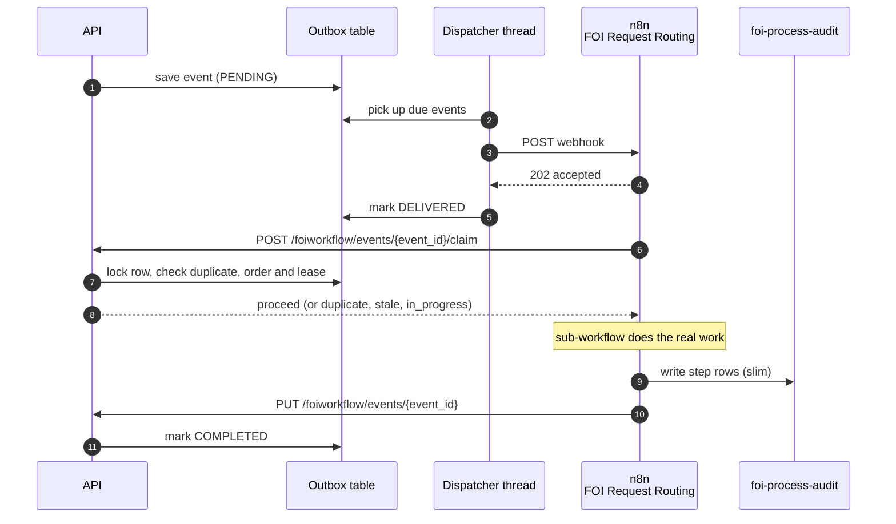
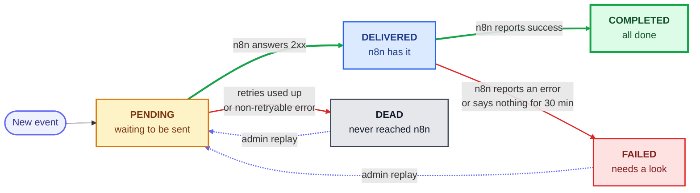
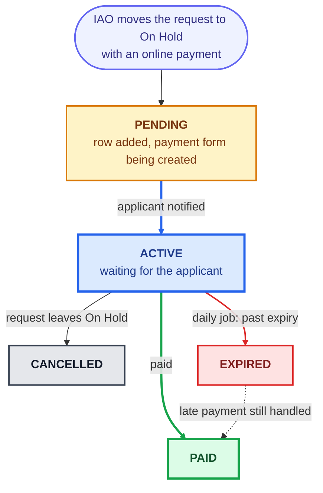

# FOI n8n Events: Developer Guide

How FOI workflow events travel from the API to n8n, and how to find out what happened when something goes wrong.

Three stores are involved. Learn these three and you can troubleshoot most workflow problems.

| Store | Where it lives | One line description |
|---|---|---|
| `FOIWorkflowEventOutbox` | Postgres (FOI requests DB) | The API's "to send" list. One row per event sent to n8n, with its delivery status. |
| `foi-process-audit` | n8n Data Table | n8n's diary: one slim row per processing step, plus a row when an event is skipped. Write-only: nothing in the event flow reads it, so it can be purged. |
| `foi-payment-sla` | n8n Data Table | One row per online fee payment that is waiting for the applicant. Drives payment expiry. |

The two n8n tables are not in Postgres. Open them in n8n under **Data tables** and filter by column.

---

## 1. The big picture

When `WF_DEFAULT_ENGINE=n8n`, the API never calls n8n directly from a user request. It writes the event to the outbox, and a background thread sends it.



Things to remember:

- **`event_id`** is a uuid created once per event (n8n rejects an event without it). It is the same in the outbox, the audit table, the error table and the API logs. Always start a search with it.
- **The claim** is what makes processing safe to repeat. Before it does any work, FOI Request Routing asks the API (`POST /foiworkflow/events/{event_id}/claim`) and gets one of four answers: `proceed`, `duplicate` (the event already COMPLETED), `stale` (a newer state event was already applied for the request) or `in_progress` (another n8n execution holds the claim). The answer comes from Postgres (the outbox rows only; there is no separate ordering table), inside one transaction, with claims for one request serialised by an advisory lock, so two executions can never both proceed.
- The `202` from n8n only means "received". The real result arrives later in the PUT callback. That is why the outbox has both `DELIVERED` and `COMPLETED`.
- If something ends badly, an admin **replays** the event. The same payload is sent again with the same `event_id`.

---

## 2. `FOIWorkflowEventOutbox`

### Columns

| Column | Meaning |
|---|---|
| `eventid` | The `event_id` (unique). Use it to look up a row. |
| `eventname` | Type of event, for example `foi-intake-complete`, `foi-ministry-complete`, `foi-manage-payment`. |
| `payload` | The full JSON sent to n8n. Can contain personal information, so the API never returns it. |
| `status` | See the diagram below. |
| `attempts` | How many times the dispatcher tried to send it. Reset to 0 on replay. |
| `nextattemptat` | When it is due next (UTC). |
| `lasterror` | Why it is not healthy. See the table below. |
| `n8nexecutionid` | The n8n execution that handled it (recorded by the claim, confirmed by the callback). The Error Handler uses it to map a failed run to its event. |
| `claimedat` | When an n8n execution claimed the event. While the claim is younger than `N8N_OUTBOX_CLAIM_LEASE_MINUTES`, another execution is told `in_progress`. Cleared by the callback and by a replay. |
| `rawrequestid`, `foirequestid`, `ministryrequestid`, `requeststatus` | The request the event is about, recorded by the claim. Indexed: use them to find the events of one request instead of searching the payload. |
| `payloadscrubbedat` | Set when the retention job removed the personal data from `payload`. |
| `replaycount` | How many times it was replayed. |
| `deliveredat`, `completedat`, `created_at`, `updated_at` | Timestamps (UTC). |

### Statuses



| Status | Needs action? |
|---|---|
| `PENDING` | No. It is waiting for its first send or the next retry. If it stays for a long time, see the troubleshooting table. |
| `DELIVERED` | No, unless it stays longer than 30 minutes. A "sweeper" will then flag it `FAILED`. |
| `COMPLETED` | No. |
| `FAILED` | **Yes.** Find the cause, then replay. |
| `DEAD` | **Yes.** Find the cause, then replay. |

Retries use exponential backoff (30 s, 60 s, 120 s, ... with some randomness). With the defaults, a send that keeps failing goes `DEAD` after about 4 to 8 minutes. A callback can also move a `PENDING` row straight to `COMPLETED`, for the case where the API died after n8n accepted the event.

### What `lasterror` tells you

| `lasterror` starts with | Meaning |
|---|---|
| `HTTP 401`, `403`, `404` (any 4xx except 429) | n8n rejected the call: wrong auth header, wrong webhook path or the workflow is not active. Not retried, goes `DEAD`. |
| `HTTP 429`, `HTTP 5xx`, or an exception name such as `ReadTimeout`, `ConnectionError` | n8n is busy or down. Retried, goes `DEAD` once attempts run out. |
| `N8N_BASE_URL is not configured` | Missing environment variable. Goes `DEAD`. |
| `Retries exhausted` | The row was picked up the maximum number of times without a result being saved (for example the pod kept restarting). |
| `NO_OUTCOME` | n8n accepted the event but never reported back within `N8N_OUTBOX_NO_OUTCOME_MINUTES`. The run may have succeeded or crashed: check `claimedat` and `n8nexecutionid` on the outbox row, and the step rows in the audit table. |
| `ENQUEUE_FAILED` | The API could not even save the event (3 tries), so it wrote this `DEAD` row as a last resort. |
| `<workflow> > <node>: <message>` | n8n reported the run failed. The text names the failing workflow and node. |

---

## 3. `foi-process-audit`

A write-only diary of what n8n did. **Nothing in the event flow reads it** (the duplicate check, the ordering check and the failed-execution lookup all use the API, see section 1), so it can be purged on a schedule (workflow **FOI Audit Retention**, created inactive).

| `process_type` | Written by | Meaning |
|---|---|---|
| `raw-request-process`, `foi-request-process`, `ministry-request-process`, `ministry-request`, `fee-process` | The sub-workflows | One row per processing step (a sentence in `comments`). The payload is **not** copied into the row; read it from the outbox by `event_id` while it is retained |
| `event-duplicate` | Routing | The claim answered `duplicate`: an earlier run already completed this event, nothing was applied again |
| `event-stale-skipped` | Routing | The claim answered `stale`: a newer state event for the same request was already applied |
| `event-in-progress` | Routing | The claim answered `in_progress`: another execution holds the claim and reports the outcome |
| `other` | Routing | Invalid payload (answered with 400) or an event type with no processing. Keeps the raw body, because such an event may have no outbox row |

Useful columns: `event_id`, `event`, `process_type`, `execution_id`, `raw_request_id`, `foi_request_id`, `ministry_request_id`, `status`, `comments`, `occurred_at`.

A healthy event now looks like this (the sub-workflow row runs as its own execution, so its `execution_id` differs; match rows by `event_id`):

```
process_type              event                  event_id      execution_id
ministry-request-process  foi-ministry-complete  8846f942-...  2036
```

There are no `event-received` / `event-completed` rows any more. Their jobs moved:

| Job | Used to be | Now |
|---|---|---|
| Do not run twice | n8n looked for an `event-completed` row | The claim answers `duplicate` when the outbox row is COMPLETED |
| Do not run twice at the same time | Not handled | The claim answers `in_progress` while another execution holds a live claim (`claimedat`) |
| Do not go back in time | n8n compared with the newest `event-received.occurred_at` | The claim compares with the newest `stateoccurredat` on the outbox rows of the same request, atomically (a ministry event also records its raw request id, so it counts for the raw request too) |
| Find the failure | The Error Handler read the `event-received` row by `execution_id` | The Error Handler calls `GET /foiworkflow/executions/{id}/event`; the claim recorded the execution on the outbox row |

Audit inserts never block a run: if one fails, processing continues (the audit row is lost, the event is not).

---

## 4. `foi-payment-sla`

### What it is

An n8n Data Table with **one row per online fee payment that is waiting for the applicant**. It records which request the payment belongs to, the payment form ids and link, when the payment expires and what state the row is in.

Key columns:

| Column | Meaning |
|---|---|
| `sla_type` | Always `payment-expiry`. |
| `sla_status` | `PENDING`, `ACTIVE`, `PAID`, `CANCELLED` or `EXPIRED`. |
| `ministry_request_id`, `foi_request_id`, `file_number` | Which request. Rows are looked up by `ministry_request_id`. |
| `form_id`, `submission_id`, `payment_url` | The Form.io payment submission and the link sent to the applicant. |
| `payment_expiry_date` | The date the applicant must pay by. |
| `expires_at` | Fallback deadline (UTC). End of `payment_expiry_date` in Vancouver time, or 20 days after creation when no valid date was sent. |
| `next_state_name` | The request status to move to once the payment is made. |
| `applicant_correspondence_id`, `template_name`, `service_key`, `prev_status` | Used for the notification emails. |
| `started_execution_id`, `completed_execution_id`, `completed_at` | n8n executions that opened and closed the row. |
| `comments` | Human readable note of the last change. Start here when troubleshooting. |
| `metadata` | The original event, so the flow can continue later. |

### Why it exists

The old Camunda process kept one long-running instance per payment, sleeping with a 20 day timer. n8n handles every event as a short, separate run and has no long waits. So instead of a sleeping process, the "payment is waiting" fact is stored in this table, and a **daily job** looks at it. The same row also lets a later PAID or CANCELLED event find the right payment and know which status to move the request to.

### How it works



Step by step (all steps are done by the **FOI Fee Processing** workflow unless noted):

1. **Start.** When the IAO moves a request to On Hold with an online payment, **FOI IAO Complete Process** starts Fee Processing. It adds a `PENDING` row, creates the Form.io payment submission, saves `form_id`, `submission_id` and `payment_url` on the row, emails the applicant and promotes the row to `ACTIVE`. If this step is run again (replay), it reuses the stored Form.io ids instead of creating a second submission.
2. **Paid.** The API sends a `foi-manage-payment` event (through the outbox). Fee Processing finds the newest `ACTIVE` row for the request, updates the form, sends the confirmation, closes the row as `PAID`, then posts `foi-iao-complete` with `next_state_name` to move the request on.
3. **Cancelled.** If the request leaves On Hold while the payment is `ACTIVE`, the payment is cancelled and the row becomes `CANCELLED`.
4. **Expired.** The **FOI Payment Expiry SLA Job** runs every day at 1 PM. It takes every `ACTIVE` row where today is within one day of `payment_expiry_date` or later (or `expires_at` when there is no date). For each one it sends an expiry event to Fee Processing, which emails the applicant and sets the row to `EXPIRED`. Because it takes *every* overdue row, a missed run is caught up the next day. The job only runs while the workflow is active in n8n.
5. **Late events.** A PAID or CANCELLED event after expiry still finds the `EXPIRED` row and is handled normally. This is why rows must never be deleted.

A one-time Camunda-to-n8n backfill (admin endpoints in the API, enabled by `PAYMENT_SLA_BACKFILL_ENABLED`) created rows for payments that were already waiting in Camunda. Those rows have `comments` starting with `BACKFILL(camunda)`.

### Troubleshooting `foi-payment-sla`

| Symptom | What to check |
|---|---|
| Applicant paid but the request is still On Hold | 1) Outbox: is the `foi-manage-payment` event `COMPLETED`? 2) Audit table: does the `event_id` have a `fee-process` step row? 3) SLA row: is it `PAID`? |
| Applicant got no expiry email | Is the row `ACTIVE`? Does it have a `payment_expiry_date` or `expires_at`? Is **FOI Payment Expiry SLA Job** active, and did its 1 PM execution succeed? |
| Row stuck in `PENDING` | Payment setup failed part way. `comments` and `started_execution_id` point to the execution. Re-running the start is safe. |
| Two open rows for one request | `comments` will say "Other non-terminal rows found". Fee Processing uses the newest `ACTIVE` row. |
| Need to expire a payment now | Set `payment_expiry_date` to a past date. The next 1 PM run expires it. Do this only with the team's agreement. |

---

## 5. Reading the outbox and the audit table together

| Outbox status | What the outbox row and audit table show | What it means |
|---|---|---|
| `PENDING` or `DEAD`, retries shown | no `claimedat`, no audit rows | n8n never got the event. Read `lasterror`, check n8n is up and the API config. |
| `DELIVERED`, no `claimedat` | none | n8n accepted the webhook but has not claimed it yet (or the run died before the claim). Wait, or see `NO_OUTCOME` |
| `DELIVERED`, `claimedat` set | step rows may appear | n8n is working on it. After `N8N_OUTBOX_NO_OUTCOME_MINUTES` the sweeper flags it |
| `DELIVERED`, step rows for every step | all steps present | Work is done but the callback did not arrive. Check the n8n callback and `N8N_SERVICE_ACCOUNT_CLIENT_ID`. Replay is safe once the sweeper flags it: the claim lease has expired and the replay runs again, or answers `duplicate` if the callback arrived meanwhile |
| `FAILED` | `n8nexecutionid` of the failed run | The run failed. Open the execution and the `foi-execution-errors` table, fix, replay. |
| `FAILED` (`NO_OUTCOME`) | no `claimedat` or an expired one | The run was lost or failed before the claim. Replay. |
| `COMPLETED` | step rows | Healthy. |
| `COMPLETED` | `event-duplicate` or `event-stale-skipped` row | n8n skipped it on purpose and acknowledged it. |

---

## 6. Replay and outbox endpoints

Base path `/api/foiworkflow`. Payloads are never returned.

| Endpoint | Who can call | Purpose |
|---|---|---|
| `GET /events?status=DEAD,FAILED&limit=100&offset=0` | **FOI Admin** | List outbox rows (newest first, `limit` max 500). Any status can be listed. |
| `POST /events/{event_id}/replay` | **FOI Admin** | Queue one `DEAD` or `FAILED` event again. |
| `POST /events/replay` with `{"eventids": ["...", "..."]}` | **FOI Admin** | Replay 1 to 500 events. |
| `PUT /events/{event_id}` | **n8n service account only** | n8n's callback with `COMPLETED` or `FAILED`; releases the claim. Humans do not call this. |
| `POST /events/{event_id}/claim` | **n8n service account only** | n8n asks whether it may process the event: `{decision: proceed \| duplicate \| in_progress \| stale}`. Body: `executionid`, `kind` (`state` or `action`), `scope`, `scopekey`, `occurred_at`, `requestids`. `400` for bad input |
| `GET /executions/{execution_id}/event` | **n8n service account only** | The event a failed execution claimed (`found: false` if it failed before claiming). Never returns the payload |

```bash
# what needs attention?
curl -s -H "Authorization: Bearer $ADMIN" "$API/api/foiworkflow/events?status=DEAD,FAILED"

# replay one event
curl -s -X POST -H "Authorization: Bearer $ADMIN" "$API/api/foiworkflow/events/<event_id>/replay"

# replay several
curl -s -X POST -H "Authorization: Bearer $ADMIN" -H "Content-Type: application/json" \
  -d '{"eventids": ["<id1>", "<id2>"]}' "$API/api/foiworkflow/events/replay"
```

| Response | Meaning |
|---|---|
| `200` | Done. For bulk replay, always `200`: read the per-event result (`updated`, `conflict`, `notfound`). |
| `400` | Bad uuid, status or body. |
| `401` | Wrong token. For the callback it also happens when `N8N_SERVICE_ACCOUNT_CLIENT_ID` is empty. |
| `404` | Unknown `event_id`. |
| `409` | Wrong state, for example replaying a row that is not `DEAD` or `FAILED`. |

What a replay does: the row returns to `PENDING`, `attempts` goes to 0, `replaycount` goes up by one, and the dispatcher sends the **original payload** again within a few seconds. Expect these outcomes:

- The earlier n8n run had actually finished (the outbox row is COMPLETED): the claim answers `duplicate`, n8n records `event-duplicate` and acknowledges. Nothing is applied twice.
- A newer event for the same request was applied meanwhile: the claim answers `stale` and n8n records `event-stale-skipped`. This is intended. If the old change is still needed, redo the action in the app to create a new event.
- A row with `ENQUEUE_FAILED ... (payload not stored)` has no request data to send. Redo the user action instead.

---

## 7. Configuration (API environment)

| Variable | Default | Effect |
|---|---|---|
| `WF_DEFAULT_ENGINE` | `n8n` in sample.env | The dispatcher starts only when this is `n8n`. |
| `N8N_BASE_URL`, `N8N_ROUTING_WEBHOOK_PATH` | path `/webhook/foi-request-routing` | Where events are posted. |
| `N8N_WEBHOOK_AUTH_HEADER_NAME`, `N8N_WEBHOOK_AUTH_HEADER_VALUE` | empty | Header auth for the webhook. |
| `N8N_WEBHOOK_TIMEOUT_SECONDS` | 10 | Timeout per send. |
| `N8N_WEBHOOK_RETRY_MAX_ATTEMPTS` | 5 | Sends before `DEAD`. |
| `N8N_WEBHOOK_RETRY_BACKOFF_SECONDS`, `N8N_WEBHOOK_RETRY_MAX_BACKOFF_SECONDS` | 30, 3600 | Backoff start and cap. |
| `N8N_OUTBOX_DISPATCHER_ENABLED` | true | Switch the dispatcher and sweeper off for one pod. Running on several pods is safe. |
| `N8N_OUTBOX_DISPATCH_INTERVAL_SECONDS`, `N8N_OUTBOX_BATCH_SIZE` | 5, 10 | How often to check and how many rows per pass. |
| `N8N_OUTBOX_SWEEP_INTERVAL_SECONDS`, `N8N_OUTBOX_NO_OUTCOME_MINUTES` | 300, 30 | How often to sweep, and how long to wait for n8n's outcome. Keep the minutes above the longest normal run. |
| `N8N_OUTBOX_CLAIM_LEASE_MINUTES` | `N8N_OUTBOX_NO_OUTCOME_MINUTES` (30) | How long a claim by one n8n execution blocks another execution of the same event (`in_progress`). Keep it at or above the longest normal run. |
| `N8N_OUTBOX_SCRUB_AFTER_DAYS`, `N8N_OUTBOX_PURGE_AFTER_DAYS` | 0 (never) | Retention of COMPLETED rows, run by the dispatcher thread: scrub removes the payload (personal data) and keeps the row; purge deletes the row. The duplicate check and the ordering check read COMPLETED rows, so keep the purge period far longer than an event can still be redelivered or replayed (DEAD and FAILED rows, the replayable ones, are never touched). Set them only after the FOI records owners decide the periods |
| `N8N_OUTBOX_RETENTION_INTERVAL_SECONDS`, `N8N_OUTBOX_RETENTION_BATCH_SIZE` | 3600, 1000 | How often the retention job runs and how many rows per batch |
| `N8N_SERVICE_ACCOUNT_CLIENT_ID` | empty | Keycloak client allowed to call the callback, the claim and the execution lookup. If empty, every callback is rejected and every event would end up `NO_OUTCOME`. |

**Optional, only for the one-time payment backfill, and only if you run it through the API endpoints** (not needed for normal operation):

| Variable | Default | Effect |
|---|---|---|
| `PAYMENT_SLA_BACKFILL_ENABLED` | false | The admin-only backfill endpoints exist only while this is `true`. Turn it off again after cutover. |
| `N8N_API_KEY` | empty | n8n public API key used to write the `foi-payment-sla` rows. It also needs `N8N_BASE_URL` (above). Without it the backfill fails. |

---

## 8. Troubleshooting

### SQL cookbook (FOI requests database)

```sql
-- events that need attention
SELECT outboxid, eventid, eventname, status, attempts, nextattemptat, lasterror,
       replaycount, n8nexecutionid, deliveredat, completedat
FROM "FOIWorkflowEventOutbox"
WHERE status IN ('DEAD','FAILED')
ORDER BY outboxid DESC;

-- one event
SELECT * FROM "FOIWorkflowEventOutbox" WHERE eventid = '<event_id>';

-- events for one request (ids and file numbers are inside the payload)
SELECT eventid, eventname, status, lasterror, created_at
FROM "FOIWorkflowEventOutbox"
WHERE payload::text LIKE '%CTZ-2026-004858%'
ORDER BY outboxid;

-- backlog
SELECT status, count(*), min(created_at) AS oldest
FROM "FOIWorkflowEventOutbox"
WHERE status IN ('PENDING','DELIVERED')
GROUP BY status;

-- problems grouped by cause
SELECT status, split_part(lasterror, ':', 1) AS cause, count(*)
FROM "FOIWorkflowEventOutbox"
WHERE status IN ('DEAD','FAILED')
GROUP BY 1, 2 ORDER BY 3 DESC;
```

Payloads can contain personal information. Query them only when needed and do not paste them into tickets.

### In n8n

- **Data tables > `foi-process-audit`**: filter by `event_id` for the step rows, or by `raw_request_id`, `foi_request_id` or `ministry_request_id` for a whole request. The rows older than the retention period are purged.
- **Events of one request in the API database** (indexed, set by the claim): `SELECT eventid, eventname, status, lasterror FROM "FOIWorkflowEventOutbox" WHERE ministryrequestid = '5265' ORDER BY outboxid;` (same for `rawrequestid`, `foirequestid`).
- **Data tables > `foi-execution-errors`**: the failed workflow, node and error message for an event.
- **Data tables > `foi-payment-sla`**: filter by `ministry_request_id`.
- **Executions**: open the id from `n8nexecutionid` or from an audit row.

### Symptom guide

| Symptom | Likely cause | What to do |
|---|---|---|
| A change in the app has no effect and the outbox row stays `PENDING` | Dispatcher not running (`WF_DEFAULT_ENGINE` is not `n8n`, dispatcher disabled, pod down) or the row is waiting for its next retry | Look for `n8n workflow outbox dispatcher started` in the API log. Check `attempts` and `nextattemptat`. |
| `DEAD` with `HTTP 401/403/404` | Wrong webhook auth, workflow inactive, wrong path | Fix the config, then replay. |
| `DEAD` with `ReadTimeout`, `ConnectionError` or `HTTP 5xx` | n8n was down longer than the retry window | Bring n8n up, then bulk replay. |
| `DEAD`, `N8N_BASE_URL is not configured` | Missing variable | Set it, restart the API, replay. |
| `DEAD`, `ENQUEUE_FAILED` | Database problem when the event was created | Search the API log for the `event_id`. Replay if the payload was stored, otherwise redo the action. |
| `FAILED`, message `<workflow> > <node>: ...` | The n8n run failed | Open the execution, fix, replay. |
| `FAILED`, `NO_OUTCOME` | n8n accepted but never called back | Check `claimedat`, `n8nexecutionid` and the step rows (see section 5). |
| Replayed event shows `COMPLETED` but nothing changed | n8n skipped it as duplicate or stale | Read `comments` on the audit row. This is by design. |
| Every callback returns 401 | `N8N_SERVICE_ACCOUNT_CLIENT_ID` is empty or does not match the token's `azp` claim | Fix the variable. |
| Healthy events get `NO_OUTCOME` | `N8N_OUTBOX_NO_OUTCOME_MINUTES` is shorter than real run times | Raise it. |

---

## 9. Rules for maintainers

- `event_id` and `occurred_at` are set once, when the event is created, and stored in the payload. Never regenerate them on retry or replay: the duplicate and ordering checks depend on them.
- Never make a workflow decision from `foi-process-audit`. It is a diary that gets purged. Anything n8n needs to decide goes through the claim or the outbox.
- Never delete `foi-payment-sla` rows. A late payment needs the old row.
- Change outbox rows through the service or the replay endpoints, not by hand. If you must reset a row by hand, set `status='PENDING'`, `attempts=0`, `claimedat=NULL`, `nextattemptat=(now() at time zone 'utc')` and add 1 to `replaycount`, which is exactly what a replay does.
- A new event type needs a branch in the `Route Event` node of FOI Request Routing. If it changes request state, also add it to the lists in the `Build Claim Request` node, otherwise it is treated as an action event and is never skipped as stale.
- A new outbox status needs: the `OutboxStatus` enum, a migration for the table's check constraint, the rules in `acknowledge()` and `replay()`, and an update to this guide.
- A new audit insert node in a sub-workflow must not copy the payload into `metadata` and must continue on error.
- Log `event_id`, never the payload.
- The dispatcher is started from `wsgi.py` inside the API process. There is no separate worker.

---

## 10. Code map

| Area | File |
|---|---|
| Table model, statuses, queries | `request-management-api/request_api/models/FOIWorkflowEventOutbox.py` |
| Table migrations | `request-management-api/migrations/versions/1b34e2d861aa_create_FOIWorkflowEventOutbox_Table.py`, `c01e2a8c31f2_outbox_claim_watermark_retention.py` |
| Outbox logic: save, pick up, claim, acknowledge, sweep, replay, retention | `request-management-api/request_api/services/workflowoutboxservice.py` |
| Creating events and posting them to n8n | `request-management-api/request_api/services/external/n8nworkflowservice.py` |
| Background dispatcher, sweeper and retention | `request-management-api/request_api/services/external/n8nworkflowoutboxdispatcher.py` |
| Endpoints | `request-management-api/request_api/resources/foiworkflow.py` |
| Tests | `request-management-api/tests/services/test_workflowoutboxservice.py`, `test_workflowoutboxclaim.py`, `test_n8nworkflowoutboxdispatcher.py`, `test_n8nworkflowoutboxretention.py` |

n8n workflows involved: **FOI Request Routing** (entry point, claim, routing, acknowledgement), **FOI Backend API Manager** (the `foi-event-claim`, `foi-event-ack` and `foi-event-by-execution` categories), **FOI Error Handler** (reports failures to the API and sends alerts), **FOI Audit Retention** (purges old audit and error rows), **FOI Fee Processing**, **FOI IAO Complete Process** and **FOI Payment Expiry SLA Job** (payment lifecycle).
